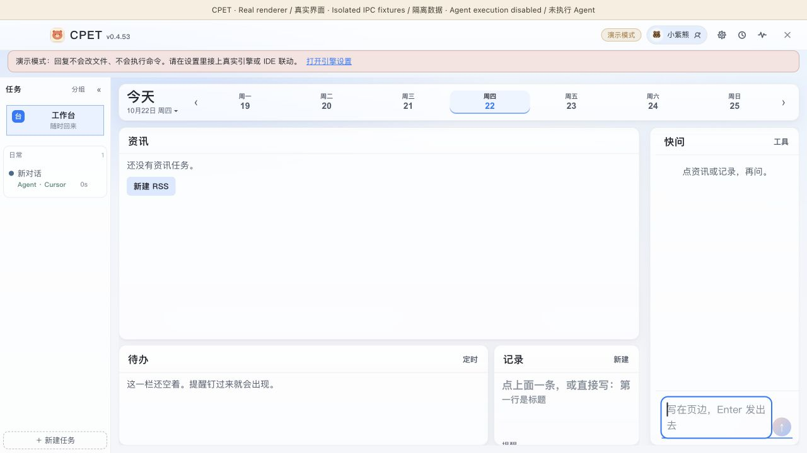
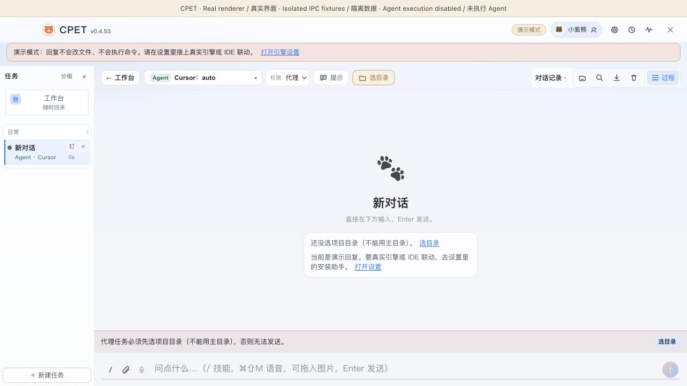
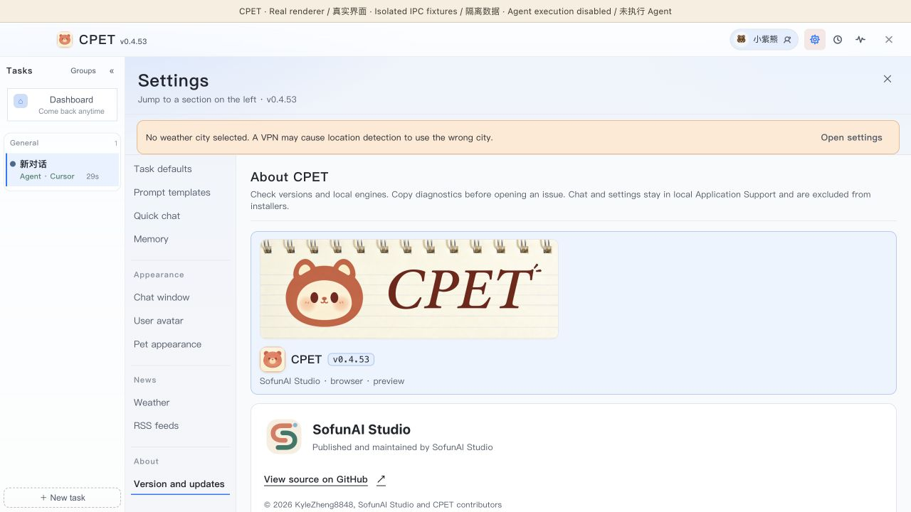

# CPET · Interface walkthrough / 界面演示

**v0.4.53 · 2026-10-22**

[Watch / 下载 MP4](https://github.com/KyleZheng8848/cpet/releases/download/v0.4.53/cpet-renderer-walkthrough-0.4.53.mp4)

Captured with Computer Use from the actual React renderer running in a browser with isolated in-memory Electron IPC fixtures. A visible capture label identifies this mode. No personal settings, chat history, agent invocation, IDE hooks or model replies are used. The video is silent, bilingual and edited from sampled frames. It demonstrates workspace/task navigation, settings, immediate language switching and the real SofunAI publisher component.

通过 Computer Use 操作真实 React 渲染界面，Electron IPC 使用隔离的内存示例数据，画面顶部明确标注预览模式。未读取个人设置、聊天记录，未调用 Agent、配置 IDE hooks 或伪造模型回复。视频带双语字幕、无旁白，由采样帧剪辑，展示工作台、任务、设置、即时语言切换和真实 SofunAI 出品组件。

This is not a native desktop pet recording or an end-to-end agent execution demo. Native Computer Use footage remains pending because this session only exposes browser control. No fixture adapter is shipped as application logic.

这不是原生桌宠录像或 Agent 执行全过程。当前会话只开放浏览器控制，原生 Computer Use 录像仍待补；隔离数据适配器不进入应用发布源码。
