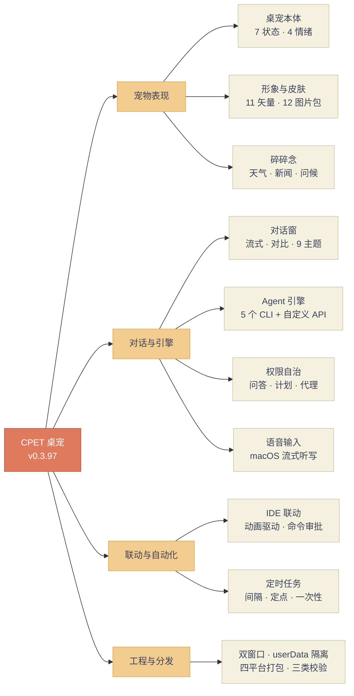
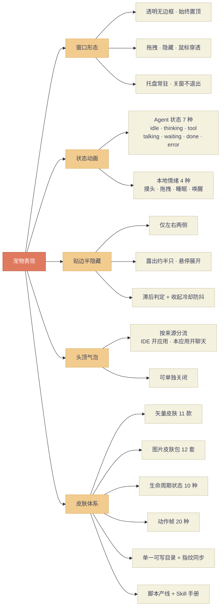
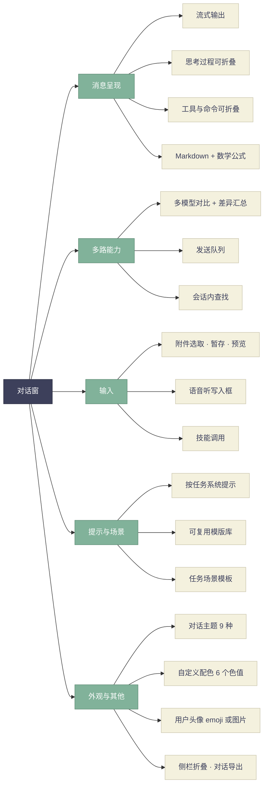
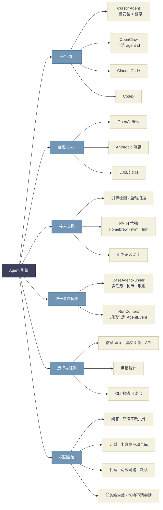
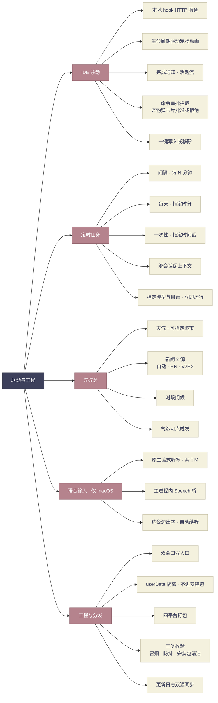
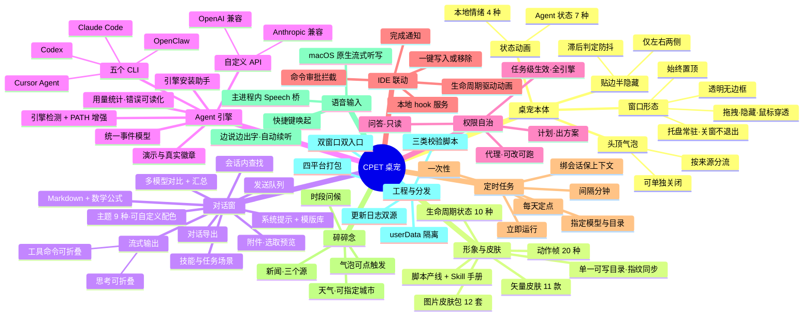

# CPET 功能脑图

> 版本 0.3.97 · 整理日期 2026-07-28
> 所有条目均来自代码与资源真源，数量已逐项核对（见每节「出处」）。未实现或仅规划的功能不列入。

---

## 一、总览

十个功能域按四层归类。此图与下面四张分域图都用 `flowchart` 语法，GitHub、语雀、Typora、Obsidian 及主流 Markdown 渲染器均可直接显示。

### 1. 宠物表现

### 2. 对话窗

### 3. Agent 引擎与权限

### 4. 联动、自动化与工程

### 附：mindmap 语法版

同样内容的 `mindmap` 写法，结构更紧凑，但**需要渲染器支持 mermaid 9.3 以上**，部分平台会显示失败。上面的 `flowchart` 版兼容性更好，优先使用。

---

## 二、桌宠本体

**Agent 状态（7 种）**：`idle`、`thinking`、`tool`、`talking`、`waiting`、`done`、`error`
**本地情绪（4 种，临时覆盖 Agent 状态）**：`petted` 摸头、`dragged` 拖拽、`sleeping`、`wake`

| 能力 | 说明 |
|------|------|
| 窗口形态 | 透明无边框、始终置顶、可拖拽、可隐藏、可设鼠标穿透 |
| 托盘常驻 | 关闭窗口不退出应用，退出时才停服务 |
| 贴边半隐藏 | 仅左右两侧；收起露出约半只，悬停展开；滞后判定 + 收起冷却防抖 |
| 头顶气泡 | 按来源分流：IDE 联动点开对应应用，本应用对话点开聊天窗；气泡可单独关闭 |
| 右键菜单 | 皮肤切换、隐藏、退出等 |

出处：`src/shared/types.ts` 的 `PetState` / `PetMood` / `PetDockEdge`，`src/main/windows.ts`，`src/renderer/src/pet/Pet.tsx`、`ThoughtBubble.tsx`

---

## 三、形象与皮肤

| 维度 | 数量 | 内容 |
|------|------|------|
| 矢量皮肤 | **11 款** | 小紫熊、薄荷猫、蜜桃团、钢蓝机、熊猫、牛马、坤坤、柴犬、卡皮巴拉、青蛙、黄脸 |
| 图片皮肤包 | **12 套**（含 1 示例） | 布布嘟嘟、奶油包子、青花瓷兔、黄油小熊、黄油吐司、cuppy 表情包、赛博幽灵、像素蛙、代码小精灵、云朵羊、手账水彩、示例包 |
| 生命周期状态 | **10 种** | idle、thinking、tool、talking、done、error、sleeping、waiting、petted、dragged |
| 贴边专属贴图 | 4 种 | docked、docked-left、docked-right、docked-top |
| 动作帧 | **20 种** | wave、bow、clap、dance、stretch、yawn、eat、drink、read、music、code、coffee、love、angry、confused、celebrate、thumbs、rain、snow、birthday |

**目录模型**：安装包内 `Resources/skins` 只作种子，运行时唯一认 `userData/skins`；内置包带 fingerprint 随版本刷新，用户自建包不被覆盖。

**生产方式**：`scripts/` 下 30 个脚本串成「出图 → 抠图 → 状态帧 → 贴边图 → 校验」产线；规范固化在 `assets/skins/LIFECYCLE.json`、`ACTION_CATALOG.json`；交付标准写进 Skill `.cursor/skills/cpet-cute-skins/`（禁项 + 过门）。

---

## 四、对话窗

| 功能 | 说明 | 组件 |
|------|------|------|
| 流式输出 | 边生成边显示 | `Chat.tsx`、`Blocks.tsx` |
| 思考过程 | 可开关，开则默认折叠 | `DetailToggles.tsx` |
| 工具与命令 | 可开关，开则默认折叠 | 同上 |
| 多模型对比 | 多路并行 + 差异汇总折叠 | `CompareView.tsx`、`compareDiff.ts` |
| 发送队列 | 连续发送排队执行 | `SendQueue.tsx` |
| 会话内查找 | 在当前对话中搜索 | `ChatFindBar.tsx` |
| 附件 | 选取、暂存、预览 | `Composer.tsx`、`attachments.ts` |
| 系统提示 | 按任务配置 + 可复用模版库 | `SystemPromptEditor.tsx` |
| 技能 | 列出并调用可用 skills | `skills.ts` |
| 任务场景 | 预置场景模板 | `taskScenarios.ts` |
| 对话导出 | 导出会话内容 | `chatExport.ts` |
| 渲染 | Markdown + KaTeX 数学公式 | `MarkdownHtml.tsx`、`markdown.ts` |
| 用户头像 | emoji 或自定义图片 | `UserAvatarFace.tsx`、`userAvatar.ts` |
| 侧栏 | 任务列表可折叠 | `Chat.tsx` |

**对话主题（9 种）**：手帐纸（暖色纸面）、墨夜（深色编辑台）、青瓷（冷调清爽）、暮色（暖暗琥珀）、蔷薇（浅粉柔光）、岩灰（冷静中性）、抹茶（草木清新）、极光（深色霓彩）、自定义。

自定义主题可调 6 个颜色变量：`paper`、`paper2`、`ink`、`inkDim`、`accent`、`accent2`。出处 `src/shared/chatUi.ts`

---

## 五、Agent 引擎

| 引擎 | 类型 | 安装助手支持 |
|------|------|--------------|
| Cursor Agent | CLI | **一键安装 + 登录** |
| OpenClaw | CLI | 复制命令 / 打开文档；可选 agent id |
| Claude Code | CLI | 复制命令 / 打开文档 |
| Codex | CLI | 复制命令 / 打开文档 |
| 自定义 API | OpenAI / Anthropic 兼容 | 引导填 baseUrl + Key，**无需装 CLI** |

**支撑能力**

- **引擎检测**：启动扫描各引擎安装与就绪情况（`agentDetect.ts`）
- **PATH 增强**：补 Homebrew / nvm / fnm 等路径，解决 Dock 启动找不到 CLI（`cliPath.ts`）
- **统一事件模型**：`BaseAgentRunner` 管多任务与取消，`RunContext` 把各家输出规范化成 `AgentEvent`（`src/main/agent/`）
- **模型管理**：模型目录抓取、层级 `modelProviders`、默认模型 `defaultModelRef`
- **运行模式**：演示 / 真实引擎 / API，顶栏徽章明示（`runMode.ts`）
- **用量与报错**：用量合并 `runUsage.ts`，CLI 报错可读化 `agentErrors.ts`
- **取消**：支持按会话 / 按 lane 取消

---

## 六、权限（自治等级）

| 等级 | 含义 |
|------|------|
| **问答 ask** | 只读回答，不改文件、不跑会改状态的命令 |
| **计划 plan** | 可分析与出方案，尽量不直接改仓库 |
| **代理 agent** | 可改文件、可跑命令；新任务默认此级 |

任务级生效，五个引擎与直连 API 全部适用；切换权限**不清空**引擎会话，保留上下文；默认等级可在设置里改。出处 `src/shared/agentAutonomy.ts`

---

## 七、IDE 联动

| 能力 | 说明 |
|------|------|
| 联动通道 | 本地 hook HTTP 服务 + `~/.cursor/hooks.json`，端口写入约定文件 |
| 生命周期驱动 | Cursor 里 Agent 的思考 / 工具 / 完成 / 出错推到宠物动画 |
| 完成通知 | 任务结束时提醒 |
| 活动流 | 联动活动可查看 |
| **命令审批拦截** | 开启后，Cursor 要执行命令时由宠物弹卡片给你批准或拒绝 |
| 一键配置 | 写入 / 移除联动均可一键完成 |

出处：`src/main/hookServer.ts`、`hookInbox.ts`、`setup.ts`，`src/renderer/src/chat/Approvals.tsx`，IPC `approvalRequest` / `approvalDecide` / `setIntercept`

---

## 八、定时任务

| 触发方式 | 参数 |
|----------|------|
| **间隔** interval | 每 N 分钟，最少 1 分钟 |
| **每天** daily | 指定时 0–23 与分 0–59 |
| **一次性** once | 指定时间戳执行一次 |

每个任务可单独指定：提示词、工作目录、模型、是否绑定会话以 `--resume` 保上下文。支持启用 / 停用、立即运行、全部关闭（空列表可持久化）。默认按「代理」权限执行以便真正干活。

出处：`src/shared/types.ts` 的 `ScheduledTask`，`src/main/scheduler.ts`，`src/renderer/src/chat/Schedules.tsx`

---

## 九、碎碎念 Feeds

| 类型 | 说明 |
|------|------|
| 天气 | 可指定城市，留空按出口 IP 判断；可手动刷新 |
| 新闻 | **3 个源**：自动（先 HN 失败转 V2EX）、Hacker News、V2EX |
| 时段问候 | 按早 / 中 / 晚等时段说不同的话 |
| 气泡交互 | 点击可开聊天窗，或直接打开指定应用如 Cursor |

出处：`src/main/feeds.ts`、`src/renderer/src/pet/chatter.ts`、`src/shared/chatUi.ts` 的 `NEWS_SOURCES`

---

## 十、语音输入（macOS）

- 原生流式听写，点麦克风或按 **⌘⇧M** 唤起
- 边说边出字，停顿约 1.5 秒结束，段落结束自动续听
- 识别在**主进程内**完成：koffi 加载 `libCpetSpeech.dylib`，规避子进程拿不到语音识别权限
- 结果写入输入框，**不自动发送**
- 日志：`~/Library/Logs/CPET/dictation.log`

出处：`src/main/dictation.ts`、`tools/cpet-speech/`、`src/renderer/src/chat/speechCapture.ts`

---

## 十一、工程与分发

| 维度 | 内容 |
|------|------|
| 双窗口 | `pet.html` 与 `chat.html` 两个渲染入口，宠物窗保持轻量 |
| 数据隔离 | 设置、对话、头像、自定义皮肤都在 userData，**不进安装包** |
| 打包 | macOS arm64 / x64、Windows、Linux；产物 `release/CPET-<版本>-<架构>.dmg` |
| CI | `.github/workflows/package.yml`，打 `v*` tag 可发 Release |
| 校验脚本 | 引擎冒烟 `smoke:agents`、贴边防抖 `verify-dock-hysteresis`、安装包清洁 `verify-release-clean` |
| 更新 | 更新日志双源同步（`CHANGELOG.md` + `src/shared/changelog.ts`）；配置 `CPET_RELEASES_URL` 后可检查更新 |

---

## 十二、功能边界（需要注意的限制）

这几条不是缺陷清单，是使用前提，脑图里容易被忽略：

1. **语音听写目前仅 macOS**，依赖系统 Speech 框架与原生桥。
2. **贴边半隐藏只有左右**，上下方向在 0.3.93 主动删除以降低状态组合复杂度。
3. **除 cursor-agent 外不代装 CLI**，其他引擎只提供命令与文档。
4. **真实 Agent 必须先选项目目录**，不能用主目录，因为 Agent 会写文件。
5. **未签名分发**，首次打开需右键或 `xattr -cr`。
6. **仓库改皮肤不会自动同步到已安装用户**，运行时读 userData，靠 fingerprint 触发刷新。

---

*本脑图对应 0.3.97。功能数量若有变动，以 `src/shared/types.ts`、`assets/skins/*.json` 与 `CHANGELOG.md` 为准。*
